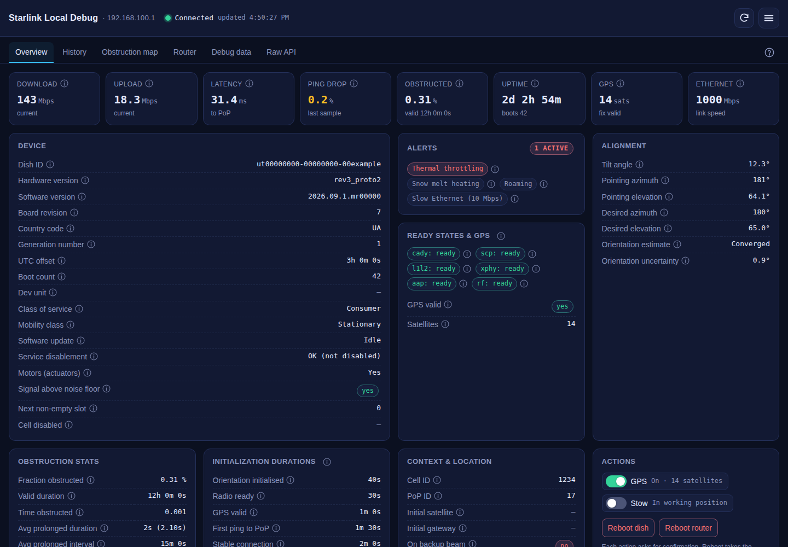
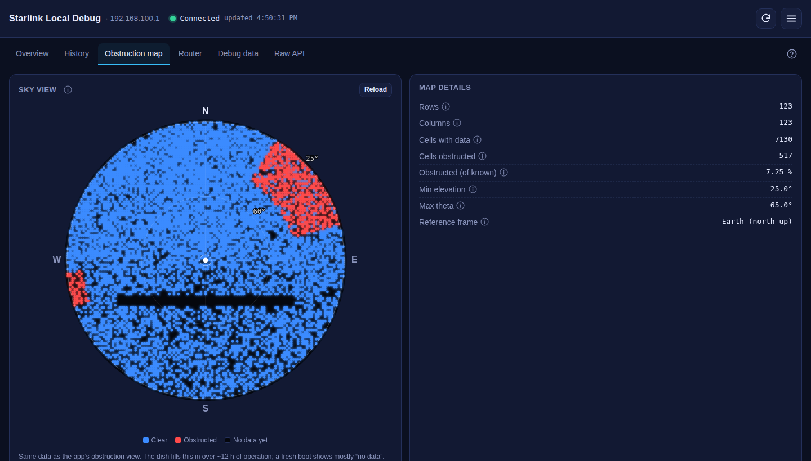
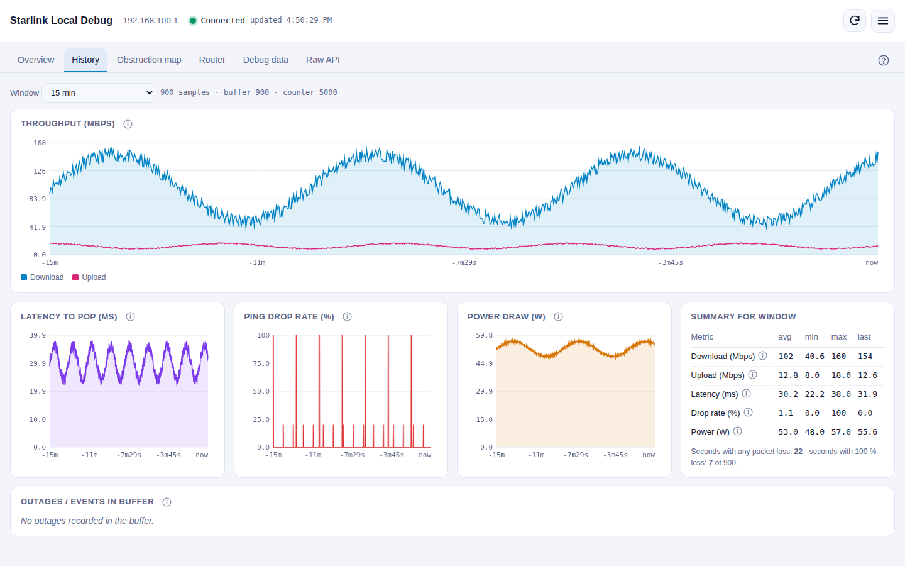
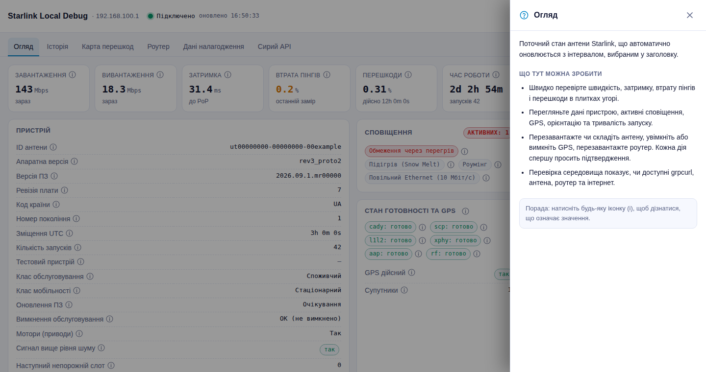

# Starlink Local Debug

A self-hosted dashboard for your Starlink dish and Wi-Fi router. It runs on your own computer
(any machine with PHP) and talks directly to the dish's local gRPC interface on
`192.168.100.1:9200` — nothing goes through Starlink's servers or any third-party service.



<p>
  
  
</p>

> Screenshots use made-up demo data, not a real dish.

## Features

| Tab | What you get |
|---|---|
| **Overview** | Live speed, latency, ping drop, obstruction, uptime, GPS and Ethernet tiles; device and firmware details; active alerts; subsystem ready states; alignment; obstruction statistics; start-up timings; cell / PoP context; GPS and Stow switches that show the dish's real state; reboot dish / router; an environment check |
| **History** | Charts of throughput, latency, ping drop and power from the dish's second-by-second buffer, with a summary table and outage list |
| **Obstruction map** | The dish's own sky map drawn like the Starlink app (north up, blue = clear, red = obstructed, black = no data), with direction/elevation read-out on hover |
| **Router** | Starlink router details, Wi-Fi status and alerts, connected clients with signal and rates |
| **Debug data** | Paste the debug JSON from the Starlink app, open a `.json` file or load live data → searchable tree and summary |
| **Raw API** | Send any request to the dish or router; the preset list comes from the device itself |

Also:

- **10 languages** — English, Українська, Español, Deutsch, Français, Português, Italiano, Polski,
  中文（简体）, 日本語 — including field labels and device status codes. Picked from your browser
  language on first visit.
- **Light / dark / auto theme.**
- **(i) tooltip on every value** explaining what it means, based on the Starlink Help Center and
  [starlink-grpc-tools](https://github.com/sparky8512/starlink-grpc-tools).
- **"About this tab" side panel** on every tab.
- **Confirmation dialog** before anything that changes the device (reboot, stow/unstow, GPS on/off,
  and non-read requests from the Raw API tab). Cancel is the default.
- **Firmware-tolerant:** request names are discovered from the device via gRPC reflection, so renamed
  requests (e.g. newer routers answering `get_status` instead of `wifi_get_status`) keep working.
- No build step, no CDN, no tracking — plain HTML, CSS and JavaScript plus one small PHP proxy.



## Requirements

- **PHP 8.1+** with `proc_open` enabled (MAMP, the built-in PHP server, Apache/nginx + PHP-FPM, …).
- **[grpcurl](https://github.com/fullstorydev/grpcurl)** — a single binary that speaks gRPC.
- The computer running it must be on the Starlink network (see *Troubleshooting* for Bypass Mode).

## Quick start

1. **Install grpcurl**

   ```sh
   brew install grpcurl          # macOS (Homebrew)
   # or download a release from https://github.com/fullstorydev/grpcurl/releases
   # and put the binary in ./bin/ (macOS: run `xattr -d com.apple.quarantine bin/grpcurl` once)
   ```

2. **Run it**

   ```sh
   git clone https://github.com/<your-account>/starlink-local-debug.git
   cd starlink-local-debug
   php -S 127.0.0.1:8080
   ```

   Open <http://127.0.0.1:8080/>.

   Using MAMP instead? Copy the folder into `/Applications/MAMP/htdocs/` and open
   `http://localhost:8888/starlink-local-debug/`.

3. The **Environment check** card on the Overview tab shows whether grpcurl was found and whether
   the dish and router answer.

## Configuration

Defaults live in [`config.php`](config.php) (dish and router addresses, timeouts, grpcurl path,
`local_only`). To override anything without touching tracked files, create `local.config.php`
next to it — it's git-ignored:

```php
<?php
return [
    'grpcurl'  => '/usr/local/bin/grpcurl',
    'max_time' => 20,
];
```

## Troubleshooting

- **Dish unreachable** — make sure you're on the Starlink network with no VPN active.
- **Bypass Mode / your own router** — add a static route on your router for `192.168.100.0/24`
  via its WAN (Starlink) interface. The Router tab stays empty in this setup; that's expected.
- **A request fails with "has no known field named …"** — the firmware renamed or removed it.
  Open **Raw API**, pick the target and look at the preset list: it shows every request the device
  currently accepts.
- **Location "not available"** — it needs *Advanced → Debug data → Starlink Location → allow access
  on local network* in the Starlink app, and most plans no longer expose it.
- **Obstruction map mostly black** — the dish fills it in over several hours after a reboot.

## How it works

```
browser ──HTTP──▶ api.php ──grpcurl──▶ dish 192.168.100.1:9200 / router 192.168.1.1:9000
                                        (SpaceX.API.Device.Device/Handle, gRPC reflection)
```

`api.php` only runs a fixed set of named commands (or, for the Raw API tab, re-encoded JSON), never
passes user input to a shell, and returns JSON to the page.

| File | Purpose |
|---|---|
| `index.html` | The whole UI (HTML, CSS, JavaScript) |
| `api.php` | Proxy: runs grpcurl, discovers request names, unwraps the history buffer |
| `config.php` | Default settings (`local.config.php` overrides, git-ignored) |
| `i18n.js` | UI strings, 10 languages |
| `i18n-fields.js` | Field labels and device status codes |
| `i18n-help.js` | Tooltip texts for every property |
| `i18n-guide.js` | "About this tab" panel and confirmation dialog texts |
| `bin/` | Optional place for a local grpcurl binary |

### Adding a language

Add an entry to `I18N.languages` in `i18n.js` and a block of strings in each `i18n*.js` file
(copy the `en` block). Any missing key falls back to English.

## Security

This is a **local tool**. It can reboot your dish and router, so:

- Don't expose it to the internet. `api.php` rejects requests from non-private addresses by default
  (`local_only` in `config.php`).
- State-changing commands require `POST` with a custom header, which browsers won't send
  cross-site without CORS approval (none is granted), so another website can't trigger them.

See [SECURITY.md](SECURITY.md) for reporting vulnerabilities.

## Credits

- [starlink-grpc-tools](https://github.com/sparky8512/starlink-grpc-tools) by sparky8512 — the
  community reference for the dish's gRPC API.
- [Oleg Kutkov's Starlink hardware research](https://olegkutkov.me/) — background on the dish's
  subsystems.
- [Starlink Help Center](https://starlink.com/support) — alert definitions and performance thresholds.
- Inspired by [Star Debug](https://github.com/ertong/star-debug).

## Disclaimer

This is an independent, unofficial project. It is not affiliated with, endorsed by or supported by
SpaceX or Starlink. "Starlink" is a trademark of Space Exploration Technologies Corp. The local
API is undocumented and may change with any firmware update. Use the device actions at your own risk.

## License

[MIT](LICENSE) © 2026 Dmytro Merkulov
